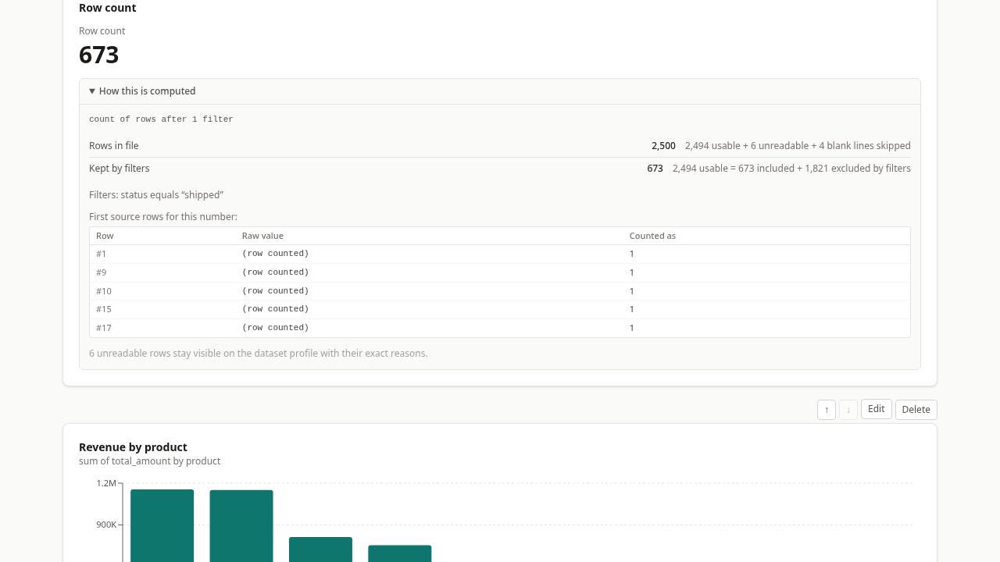
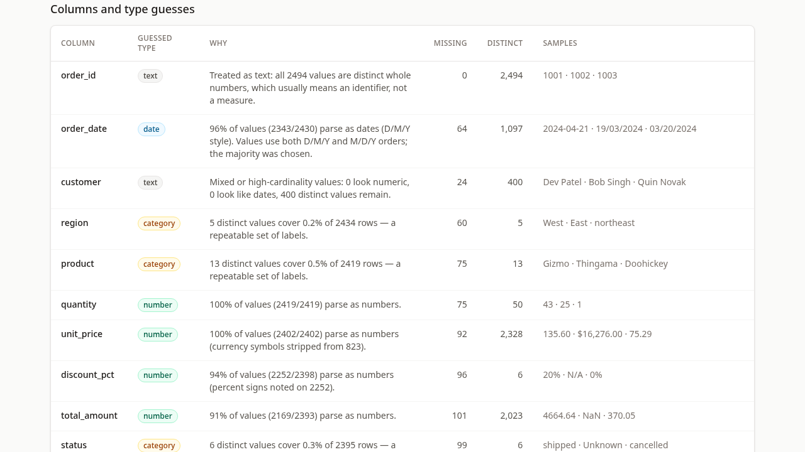
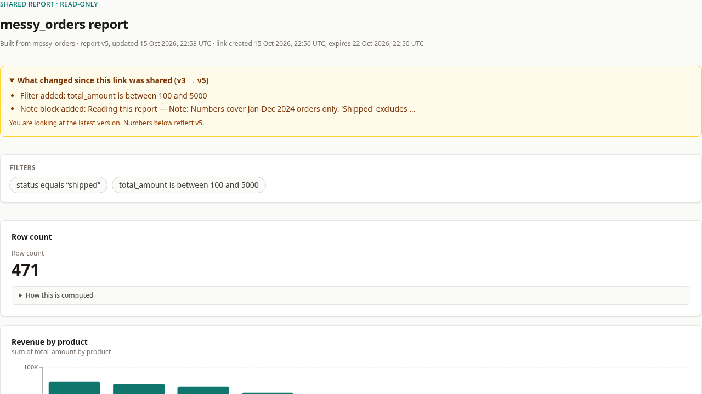

# ByteVox Report Builder

Upload a messy CSV, and get a short report where **every number can show exactly which rows it counted, which it left out, and why** — then share it read-only with an expiring link that tells viewers what changed since the link was created.

Built for the ByteVox hiring assignment. Product spec: `PRD.md` · stack and architecture: `TECHSTACK.md` · build checklist and log: `todo.md`.

## Run it

```bash
npm install
npm run setup   # prisma generate + migrate deploy → creates var/dev.db
npm run dev     # http://localhost:3000
```

Sign up with any email and an 8+ character password, then upload `sample-data/messy_orders.csv` (an intentionally messy ~2.5k-row file) to reproduce the whole demo. `npm test` — 67 tests across 7 files — prepares its own throwaway database on first run; `npm run typecheck` and `npm run build` are clean.

Requirements: Node 22.12+ (built on Node 26) and npm. No Docker, no external services — SQLite lives under `var/`, and raw uploads are stored outside any served directory. `npm run demo:data` regenerates the sample CSV.

## How my report builder works

### One pipeline, one compute path

`upload → decode → parse with row accounting → profile each column (type + reason) → persist → each report block computed from stored rows → share links resolve by token`

All of it happens server-side. The importer, the type inference, and every aggregation live in typed modules; pages render the return value of one pure compute engine (`src/lib/compute/engine.ts`) and the browser only draws pixels (Recharts). The builder, the owner's view, and the public share viewer call the exact same functions, so the same number cannot disagree with itself across screens — a block's trace panel is produced in the same call as its value.

### Nothing is silently dropped

Messy files are the point of the assignment, so here is the full list of catches the pipeline makes on its own sample file, what it does about each, and where you can see it:

| What the file does | What the app does | Where it is visible |
| --- | --- | --- |
| 4 blank lines | Counted, classified, never parsed as records | Profile ledger: "4 blank lines skipped" |
| 5 rows with the wrong field count (2 short, 3 long) | Rejected individually; the rest of the file still parses | "Could not be read" list — line number, `Invalid Record Length: expect 14, got 15`, raw snippet |
| 1 unclosed quote | Rejected with csv-parse's exact message (`Quote Not Closed …`) | Same list, with the raw snippet |
| Duplicate header `region` | Renamed `region (2)`, noted | Import notes + columns table |
| Empty header cell | Named `column_14`; then dropped from the profile because it is empty on every row — both facts stated | Import notes |
| All-empty column (`internal_code`) | Dropped from the profile, named in the notes | Import notes |
| Impossible/bad dates (`31/02/2024`) | Not counted as parsed dates; excluded from date math with the exclusion shown | Column reason ("x% parse as dates"), raw value kept |
| Mixed unambiguous date orders (D/M/Y and M/D/Y both present) | Majority dialect chosen, day-only ISO used internally, ambiguity flagged in plain English | Column reason: "Values use both D/M/Y and M/D/Y orders; the majority was chosen" |
| `$30`, `1,234.50`, `15%`, stray spaces | Parsed for math; the original raw value is preserved and shown beside every parsed value | Profile samples, trace "First source rows" |
| `N/A`, `unknown`, `-`, empty cells | Treated as missing: excluded from value metrics, counted by name in the trace | Trace ledger: `included = values used + blank + unparseable` |
| Identifier-looking column (all values distinct whole numbers) | Guessed `text`, with the reason ("all values are distinct whole numbers, which usually means an identifier, not a measure") | Column reason |
| `<script>` cell | Rendered as literal text everywhere (React escaping, no `dangerouslySetInnerHTML` in the codebase) | Preview and table blocks |

The profile page surfaces the import's own arithmetic, and a test asserts it every run:

```
2,506 physical lines = 1 header + 2,494 usable rows + 6 unreadable rows + 4 blank lines + 1 continuation of an embedded-newline cell
```

### Every number shows its work

Each metric, chart, and table block carries a "How this is computed" panel containing:

1. a formula sentence (`count of rows after 1 filter`, `sum of total_amount, 1,821 rows excluded by filters …`);
2. two reconciling ledgers — `usable = included + excluded by filters`, then `included = values used + blank + unparseable` — plus the file-level totals including rows rejected at import;
3. a handful of actual source rows (row number, raw value, value as counted);
4. honest notes for anything omitted, e.g. a bar chart shows the top groups and states "N smaller groups not shown" instead of quietly truncating.



Tests assert those accounting identities on every evaluation path, and empty results show a written explanation ("no rows qualified…") rather than an empty chart or a `NaN`.

### Type guessing is explained, not just applied

Per column: ≥90% parse as numbers → `number` (thousands separators, a leading currency symbol, trailing `%` tolerated); else ≥90% parse as dates against an explicit format list → `date` (with majority-dialect handling and ambiguity flags); else ≤50 distinct values covering <50% of rows → `category`; everything else → `text`. The profile states each test's actual counts, so a wrong guess is visible and debuggable, and every threshold is a named constant in one file.

One sharp edge, stated instead of hidden: `equals`/`contains` filters match case-insensitively (so "north" finds "North"), but distinct counts and chart grouping use raw trimmed values, so "North" and "north" would appear as two groups. Both behaviors are pinned by tests.



### Sharing is safe by construction

- Links are 32 random bytes; only their SHA-256 hash is stored, and the URL is shown exactly once. Expiry is required (default 7 days, max 90) and revocable — effective on the very next request.
- The viewer resolves strictly token → report: the access layer has no unscoped "get by id", and **no endpoint serves the raw uploaded file** (bytes live outside any served directory).
- The viewer payload contains the report, its traces, and the change list — no dataset id, filename, or path (only the display name, deliberately, for traceability), no profile, no rejected rows, no owner identity. Verified by probing the rendered payload in review.
- Unknown, expired, and revoked tokens get distinct, friendly pages; none of them exposes any report content.
- Inputs are zod-validated on the server; Prisma is the only database path (grep confirms raw-query APIs appear only in Prisma's own generated client). CSV text is always rendered as plain text.

### What changed (the optional feature)

Every mutation — title, description, filters, any block edit — runs through one transactional helper: apply change → bump `Report.version` → store a small human-readable snapshot revision, all in the same transaction. Each share link records `versionAtShare`. The viewer's page diffs "the snapshot at share time" against the live report and shows, for example:

> **What changed since this link was shared (v3 → v5)**
> - Filter added: total_amount is between 100 and 5000
> - Note block added: Reading this report — Note: Numbers cover Jan–Dec 2024 orders only…



The owner sees the same diff as a live preview on the share page. Because the version bump and the snapshot are written together, the diff can never miss or invent a version.

## Decisions and trade-offs

- **Next.js 16 + SQLite via Prisma 7 (driver adapter), one process.** Reviewer setup is three commands with nothing else to install, and server code and UI share types. Prisma is pinned to the stable 7.x line because npm `latest` currently points at an 8.0.0 release candidate.
- **Every change is saved immediately; there is no Save button.** The revision trail and what-changed panel are therefore always complete and exactly match storage.
- **A generic filter list** (up to 10 ANDed conditions; contains / equals / blank / not-blank / number-between / date-between) instead of one fixed date-range + category filter — strictly more useful in practice, at the cost of not having a multi-select value picker.
- **Snapshot revisions, not diff strings, at save time.** Small human-readable snapshots (title, filters, block labels) make diffs exact and let the diff logic improve without rewriting history.
- **Recompute per request, no caches.** Share pages are `force-dynamic`, so revocation is instantly effective and there is no stale-number risk. The cost is re-reading the dataset per view — fine at this scale, with the 100× plan in `TECHSTACK.md` §8.

## What I cut for time

- Drag-and-drop upload (file picker only).
- Metric split-by-column (grouping is available via chart blocks with top-N + "(blank)" reporting).
- Table column sorting (tables are the first N rows in source order; the trace says so).
- The "new since your last visit" badge on share pages (the what-changed panel itself is built).
- The dataset delete confirmation explains the effect on reports but does not list each report's name.
- No formal screen-reader audit (native controls, labelled inputs throughout, but not tested with assistive tech).

## What could still go wrong, and what breaks first at 100×

- No rate limiting or brute-force lockout on sign-in; no email verification or password reset.
- SQLite is single-writer; concurrent heavy use is out of scope.
- Report pages load and compute the dataset in memory per request. At ~100× (millions of rows) the first failures are request memory and latency, then the JSON-per-row storage shape; the fix order is SQL-side aggregation with the same trace semantics → materialized per-version results → background imports → Postgres/libSQL (see `TECHSTACK.md` §8).
- Note blocks are author-written text shown to share viewers; an author can paste anything into them, and share viewers see the dataset's display name by design.

## Tests

`npm test` — 67 tests across 7 files:

- **Importer**: error matrix (not-a-CSV, xlsx magic bytes, bad encoding, empty, header-only, unclosed quote, ragged rows) and the no-total-loss reconciliation on the shipped sample;
- **Type inference**: threshold edges, ambiguity flags, currency/percent tolerance, identifier rule;
- **Compute engine**: aggregation semantics with missing-value exclusion, grouping, every filter kind, empty results, all-missing columns, and the accounting invariants;
- **Access control**: a second user cannot read, mutate, delete, or share another user's data; expired / revoked / unknown tokens;
- **Revisions and sharing**: snapshot diffs, token hashing, revocation, expiry via an injectable clock.

## Hours and AI usage

**Time spent:** _(fill in from the hours log in `todo.md` before submitting — the honest number, even if it ran past the plan.)_

**How AI was used:** I built this with an AI coding agent (OpenCode running DeepSeek V4.1 Flash) — scaffolding, most module code, tests, and these docs. The rule I held it to: no claim goes into the README or a demo before it survives a test or a live browser run. That rule caught a real AI mistake: the AI-written sample-data generator produced three rows it *claimed* had 15 fields but actually wrote 14 of them. The reconciliation test (`usable + rejected + blank lines + continuation lines = physical lines`) failed the moment it ran, exposed the generator bug, and the corrected fix made every number in the file ledger add up. One more, from the debugging log: an AI session misread a Playwright failure as a product bug, when the real cause was a stale element reference after a re-render — the fix was to re-snapshot before each interaction, not to touch the app. Both incidents are logged in `todo.md`.
